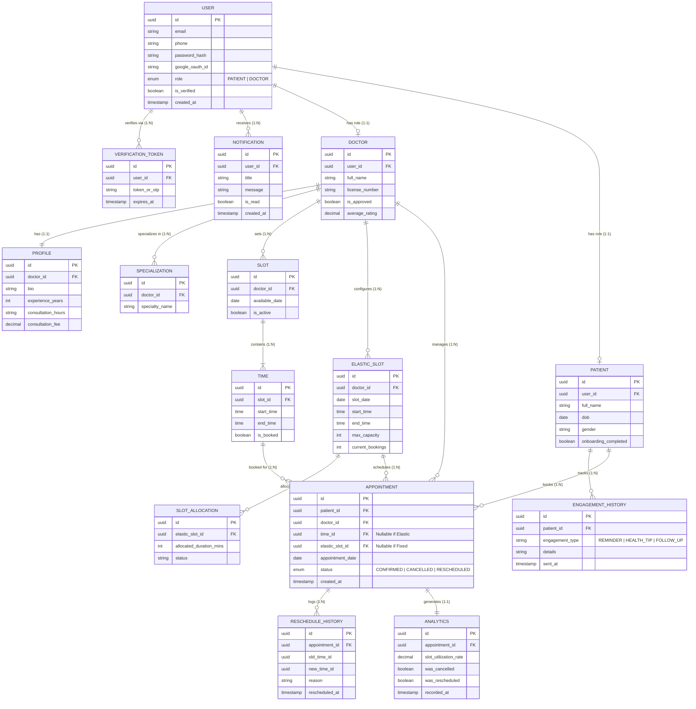

# Healthcare Appointment & Scheduling System — ER Diagram

## Project Overview
This repository contains the Entity-Relationship (ER) Diagram and schema design for the **Schedule Project Module** as part of the PearlThoughts Internship Programme.

The design provides a scalable, clear, and normalized relational model for handling user accounts, patient onboarding, doctor profiles, multi-strategy doctor availability (fixed vs. elastic slots), and appointment lifecycles with full audit logging and analytics.

---

## Core Modules

The ER diagram structures the healthcare scheduling system across five core modules:

1. **User Module**
   - Central authentication and identity management for system users.
   - Handles multi-role distinction (`PATIENT` or `DOCTOR`), account verification tokens (OTP/email link), and user notifications.
   - Entities: `USER`, `VERIFICATION_TOKEN`, `NOTIFICATION`.

2. **Patient Module**
   - Patient personal records, profile onboarding status, and engagement tracking.
   - Keeps historical logs for health tips, appointment reminders, and follow-ups.
   - Entities: `PATIENT`, `ENGAGEMENT_HISTORY`.

3. **Doctor Module**
   - Detailed doctor identity, approval/credentialing workflow, clinical profiles, and specializations.
   - Stores consultation fees, operating hours, experience, and ratings.
   - Entities: `DOCTOR`, `PROFILE`, `SPECIALIZATION`.

4. **Availability Module**
   - High-flexibility scheduling engine supporting two doctor availability paradigms:
     - **Fixed Slot Scheduling**: `SLOT` partitioned into granular fixed `TIME` intervals.
     - **Elastic Slot Scheduling**: `ELASTIC_SLOT` with capacity tracking and dynamic duration `SLOT_ALLOCATION`.
   - Entities: `SLOT`, `TIME`, `ELASTIC_SLOT`, `SLOT_ALLOCATION`.

5. **Appointment Module**
   - Core booking engine linking patients and doctors.
   - Accommodates both fixed slot bookings (`time_id`) and elastic slot bookings (`elastic_slot_id`).
   - Tracks booking status (`CONFIRMED`, `CANCELLED`, `RESCHEDULED`), complete reschedule history audit trail, and performance analytics.
   - Entities: `APPOINTMENT`, `RESCHEDULE_HISTORY`, `ANALYTICS`.

---

## Entity Relationship Diagram

### Visual Representation


---

### Mermaid ER Diagram Source



---

## Data Dictionary & Module Specifications

### 1. User Module
| Entity | Attribute | Type | Constraints / Description |
|---|---|---|---|
| `USER` | `id` | UUID | Primary Key |
| `USER` | `email` | VARCHAR | Unique email address |
| `USER` | `phone` | VARCHAR | Contact telephone number |
| `USER` | `password_hash` | VARCHAR | Secure hashed credential |
| `USER` | `google_oauth_id` | VARCHAR | Optional OAuth provider identifier |
| `USER` | `role` | ENUM | `PATIENT` or `DOCTOR` |
| `USER` | `is_verified` | BOOLEAN | Account verification flag |
| `USER` | `created_at` | TIMESTAMP | Registration timestamp |
| `VERIFICATION_TOKEN` | `id` | UUID | Primary Key |
| `VERIFICATION_TOKEN` | `user_id` | UUID | Foreign Key referencing `USER.id` |
| `VERIFICATION_TOKEN` | `token_or_otp` | VARCHAR | Verification code or token string |
| `VERIFICATION_TOKEN` | `expires_at` | TIMESTAMP | Expiration cutoff timestamp |
| `NOTIFICATION` | `id` | UUID | Primary Key |
| `NOTIFICATION` | `user_id` | UUID | Foreign Key referencing `USER.id` |
| `NOTIFICATION` | `title` | VARCHAR | Alert title |
| `NOTIFICATION` | `message` | TEXT | Alert body message |
| `NOTIFICATION` | `is_read` | BOOLEAN | Read receipt flag |
| `NOTIFICATION` | `created_at` | TIMESTAMP | Creation timestamp |

### 2. Patient Module
| Entity | Attribute | Type | Constraints / Description |
|---|---|---|---|
| `PATIENT` | `id` | UUID | Primary Key |
| `PATIENT` | `user_id` | UUID | Foreign Key referencing `USER.id` (1:1) |
| `PATIENT` | `full_name` | VARCHAR | Patient's full name |
| `PATIENT` | `dob` | DATE | Date of birth |
| `PATIENT` | `gender` | VARCHAR | Gender identity |
| `PATIENT` | `onboarding_completed` | BOOLEAN | Onboarding workflow flag |
| `ENGAGEMENT_HISTORY` | `id` | UUID | Primary Key |
| `ENGAGEMENT_HISTORY` | `patient_id` | UUID | Foreign Key referencing `PATIENT.id` |
| `ENGAGEMENT_HISTORY` | `engagement_type` | VARCHAR | `REMINDER`, `HEALTH_TIP`, `FOLLOW_UP` |
| `ENGAGEMENT_HISTORY` | `details` | TEXT | Details of communication sent |
| `ENGAGEMENT_HISTORY` | `sent_at` | TIMESTAMP | Dispatch timestamp |

### 3. Doctor Module
| Entity | Attribute | Type | Constraints / Description |
|---|---|---|---|
| `DOCTOR` | `id` | UUID | Primary Key |
| `DOCTOR` | `user_id` | UUID | Foreign Key referencing `USER.id` (1:1) |
| `DOCTOR` | `full_name` | VARCHAR | Doctor's professional name |
| `DOCTOR` | `license_number` | VARCHAR | Medical registration / license number |
| `DOCTOR` | `is_approved` | BOOLEAN | Verification & admin approval state |
| `DOCTOR` | `average_rating` | DECIMAL | Running average rating from reviews |
| `PROFILE` | `id` | UUID | Primary Key |
| `PROFILE` | `doctor_id` | UUID | Foreign Key referencing `DOCTOR.id` (1:1) |
| `PROFILE` | `bio` | TEXT | Professional biography |
| `PROFILE` | `experience_years` | INT | Total clinical experience in years |
| `PROFILE` | `consultation_hours` | VARCHAR | General weekly consultation schedule |
| `PROFILE` | `consultation_fee` | DECIMAL | Standard consultation fee |
| `SPECIALIZATION` | `id` | UUID | Primary Key |
| `SPECIALIZATION` | `doctor_id` | UUID | Foreign Key referencing `DOCTOR.id` |
| `SPECIALIZATION` | `specialty_name` | VARCHAR | e.g., Cardiology, Dermatology, etc. |

### 4. Availability Module
| Entity | Attribute | Type | Constraints / Description |
|---|---|---|---|
| `SLOT` | `id` | UUID | Primary Key (Fixed Slot Parent) |
| `SLOT` | `doctor_id` | UUID | Foreign Key referencing `DOCTOR.id` |
| `SLOT` | `available_date` | DATE | Date for the availability block |
| `SLOT` | `is_active` | BOOLEAN | Slot active toggle |
| `TIME` | `id` | UUID | Primary Key (Individual Time Window) |
| `TIME` | `slot_id` | UUID | Foreign Key referencing `SLOT.id` |
| `TIME` | `start_time` | TIME | Window start time |
| `TIME` | `end_time` | TIME | Window end time |
| `TIME` | `is_booked` | BOOLEAN | Fixed booking allocation state |
| `ELASTIC_SLOT` | `id` | UUID | Primary Key (Dynamic/Elastic Slot) |
| `ELASTIC_SLOT` | `doctor_id` | UUID | Foreign Key referencing `DOCTOR.id` |
| `ELASTIC_SLOT` | `slot_date` | DATE | Elastic block date |
| `ELASTIC_SLOT` | `start_time` | TIME | Shift start |
| `ELASTIC_SLOT` | `end_time` | TIME | Shift end |
| `ELASTIC_SLOT` | `max_capacity` | INT | Maximum concurrent / total appointments |
| `ELASTIC_SLOT` | `current_bookings`| INT | Active bookings tally |
| `SLOT_ALLOCATION` | `id` | UUID | Primary Key |
| `SLOT_ALLOCATION` | `elastic_slot_id` | UUID | Foreign Key referencing `ELASTIC_SLOT.id` |
| `SLOT_ALLOCATION` | `allocated_duration_mins` | INT | Duration assigned per consultation |
| `SLOT_ALLOCATION` | `status` | VARCHAR | Allocation status (`ACTIVE`, `RELEASED`) |

### 5. Appointment Module
| Entity | Attribute | Type | Constraints / Description |
|---|---|---|---|
| `APPOINTMENT` | `id` | UUID | Primary Key |
| `APPOINTMENT` | `patient_id` | UUID | Foreign Key referencing `PATIENT.id` |
| `APPOINTMENT` | `doctor_id` | UUID | Foreign Key referencing `DOCTOR.id` |
| `APPOINTMENT` | `time_id` | UUID | Foreign Key referencing `TIME.id` (Nullable if Elastic) |
| `APPOINTMENT` | `elastic_slot_id`| UUID | Foreign Key referencing `ELASTIC_SLOT.id` (Nullable if Fixed) |
| `APPOINTMENT` | `appointment_date`| DATE | Scheduled date |
| `APPOINTMENT` | `status` | ENUM | `CONFIRMED`, `CANCELLED`, `RESCHEDULED` |
| `APPOINTMENT` | `created_at` | TIMESTAMP | Booking creation timestamp |
| `RESCHEDULE_HISTORY` | `id` | UUID | Primary Key |
| `RESCHEDULE_HISTORY` | `appointment_id` | UUID | Foreign Key referencing `APPOINTMENT.id` |
| `RESCHEDULE_HISTORY` | `old_time_id` | UUID | Reference to previous slot/time |
| `RESCHEDULE_HISTORY` | `new_time_id` | UUID | Reference to updated slot/time |
| `RESCHEDULE_HISTORY` | `reason` | TEXT | Reason provided for rescheduling |
| `RESCHEDULE_HISTORY` | `rescheduled_at`| TIMESTAMP | Reschedule event timestamp |
| `ANALYTICS` | `id` | UUID | Primary Key |
| `ANALYTICS` | `appointment_id` | UUID | Foreign Key referencing `APPOINTMENT.id` (1:1) |
| `ANALYTICS` | `slot_utilization_rate` | DECIMAL | Efficiency / utilization metric |
| `ANALYTICS` | `was_cancelled` | BOOLEAN | Cancellation flag |
| `ANALYTICS` | `was_rescheduled` | BOOLEAN | Reschedule flag |
| `ANALYTICS` | `recorded_at` | TIMESTAMP | Analytics aggregation timestamp |

---

## Key Relationships & Cardinality Summary

1. **User Specialization**:
   - `USER (1)` ── `(0..1) PATIENT`: Each user can optionally be associated with a patient profile.
   - `USER (1)` ── `(0..1) DOCTOR`: Each user can optionally be associated with a doctor profile.
   - `USER (1)` ── `(0..N) VERIFICATION_TOKEN`: Tokens for multi-step verification.
   - `USER (1)` ── `(0..N) NOTIFICATION`: Alerts sent to the user.

2. **Doctor & Profile Structure**:
   - `DOCTOR (1)` ── `(1..1) PROFILE`: Strict 1:1 mapping for clinical details.
   - `DOCTOR (1)` ── `(0..N) SPECIALIZATION`: Doctors can possess multiple specializations.

3. **Dual Availability Architecture**:
   - **Fixed Slots**: `DOCTOR (1)` ── `(0..N) SLOT (1)` ── `(1..N) TIME`
   - **Elastic Slots**: `DOCTOR (1)` ── `(0..N) ELASTIC_SLOT (1)` ── `(0..N) SLOT_ALLOCATION`

4. **Appointment Management**:
   - `PATIENT (1)` ── `(0..N) APPOINTMENT`: Patients can book multiple appointments.
   - `DOCTOR (1)` ── `(0..N) APPOINTMENT`: Doctors manage multiple consultations.
   - `APPOINTMENT (1)` ── `(0..N) RESCHEDULE_HISTORY`: Audit log for every reschedule action.
   - `APPOINTMENT (1)` ── `(1..1) ANALYTICS`: Operational metrics generated per appointment.

---

## Repository Structure

```text
Healthcare-Appointment-Scheduling-System/
├── er-diagram.png     # ER Diagram Image
├── README.md          # Complete Documentation & Schema Specifications
└── .gitignore         # Git ignore file
```
