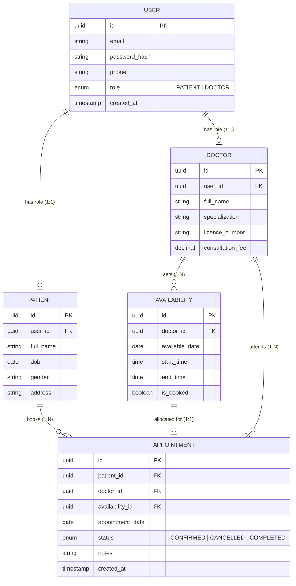

# Healthcare Appointment & Scheduling System — ER Diagram

## Project Overview
This repository contains the Entity-Relationship (ER) Diagram and schema design for the **Schedule Project Module** as part of the PearlThoughts Internship Programme.

The design provides a clear, simple, and normalized relational model for handling user accounts, patient records, doctor profiles, availability scheduling, and appointment bookings.

---

## Core Modules

The ER diagram structures the healthcare scheduling system across five core modules:

1. **User Module**
   - Central authentication and identity management for system users.
   - Handles multi-role distinction (`PATIENT` or `DOCTOR`).
   - Entity: `USER`.

2. **Patient Module**
   - Patient personal records and demographic information.
   - Entity: `PATIENT`.

3. **Doctor Module**
   - Healthcare provider profiles, medical specialization, license details, and consultation fees.
   - Entity: `DOCTOR`.

4. **Availability Module**
   - Doctor schedule time slots with date, start time, end time, and booking status.
   - Entity: `AVAILABILITY`.

5. **Appointment Module**
   - Core booking engine connecting patients, doctors, and available slots.
   - Entity: `APPOINTMENT`.

---

## Entity Relationship Diagram



---

## Data Dictionary & Module Specifications

### 1. User Module
| Entity | Attribute | Type | Constraints / Description |
|---|---|---|---|
| `USER` | `id` | UUID | Primary Key |
| `USER` | `email` | VARCHAR | Unique email address |
| `USER` | `phone` | VARCHAR | Contact telephone number |
| `USER` | `password_hash` | VARCHAR | Secure hashed credential |
| `USER` | `role` | ENUM | `PATIENT` or `DOCTOR` |
| `USER` | `created_at` | TIMESTAMP | Registration timestamp |

### 2. Patient Module
| Entity | Attribute | Type | Constraints / Description |
|---|---|---|---|
| `PATIENT` | `id` | UUID | Primary Key |
| `PATIENT` | `user_id` | UUID | Foreign Key referencing `USER.id` (1:1) |
| `PATIENT` | `full_name` | VARCHAR | Patient's full name |
| `PATIENT` | `dob` | DATE | Date of birth |
| `PATIENT` | `gender` | VARCHAR | Gender identity |
| `PATIENT` | `address` | TEXT | Residential contact address |

### 3. Doctor Module
| Entity | Attribute | Type | Constraints / Description |
|---|---|---|---|
| `DOCTOR` | `id` | UUID | Primary Key |
| `DOCTOR` | `user_id` | UUID | Foreign Key referencing `USER.id` (1:1) |
| `DOCTOR` | `full_name` | VARCHAR | Doctor's professional name |
| `DOCTOR` | `specialization` | VARCHAR | Medical specialty (e.g., Cardiology, General Medicine) |
| `DOCTOR` | `license_number` | VARCHAR | Medical practice license number |
| `DOCTOR` | `consultation_fee` | DECIMAL | Standard consultation fee |

### 4. Availability Module
| Entity | Attribute | Type | Constraints / Description |
|---|---|---|---|
| `AVAILABILITY` | `id` | UUID | Primary Key |
| `AVAILABILITY` | `doctor_id` | UUID | Foreign Key referencing `DOCTOR.id` (1:N) |
| `AVAILABILITY` | `available_date` | DATE | Date doctor is available |
| `AVAILABILITY` | `start_time` | TIME | Slot start time |
| `AVAILABILITY` | `end_time` | TIME | Slot end time |
| `AVAILABILITY` | `is_booked` | BOOLEAN | Slot booking status (`true` if reserved) |

### 5. Appointment Module
| Entity | Attribute | Type | Constraints / Description |
|---|---|---|---|
| `APPOINTMENT` | `id` | UUID | Primary Key |
| `APPOINTMENT` | `patient_id` | UUID | Foreign Key referencing `PATIENT.id` (1:N) |
| `APPOINTMENT` | `doctor_id` | UUID | Foreign Key referencing `DOCTOR.id` (1:N) |
| `APPOINTMENT` | `availability_id` | UUID | Foreign Key referencing `AVAILABILITY.id` (1:1) |
| `APPOINTMENT` | `appointment_date` | DATE | Scheduled appointment date |
| `APPOINTMENT` | `status` | ENUM | Status (`CONFIRMED`, `CANCELLED`, `COMPLETED`) |
| `APPOINTMENT` | `notes` | TEXT | Consultation notes or reason |
| `APPOINTMENT` | `created_at` | TIMESTAMP | Booking timestamp |

---

## Key Relationships & Cardinality Summary

1. **User Specialization**:
   - `USER (1)` ── `(0..1) PATIENT`: Each user can optionally be associated with a patient profile.
   - `USER (1)` ── `(0..1) DOCTOR`: Each user can optionally be associated with a doctor profile.

2. **Doctor Availability**:
   - `DOCTOR (1)` ── `(0..N) AVAILABILITY`: A doctor sets multiple availability time slots.

3. **Appointment Management**:
   - `PATIENT (1)` ── `(0..N) APPOINTMENT`: Patients can book multiple appointments.
   - `DOCTOR (1)` ── `(0..N) APPOINTMENT`: Doctors attend multiple patient appointments.
   - `AVAILABILITY (1)` ── `(0..1) APPOINTMENT`: Each availability slot is allocated to at most one appointment.

---

## Repository Structure

```text
Healthcare-Appointment-Scheduling-System/
├── README.md          # Complete Documentation & Schema Specifications
└── .gitignore         # Git ignore file
```
